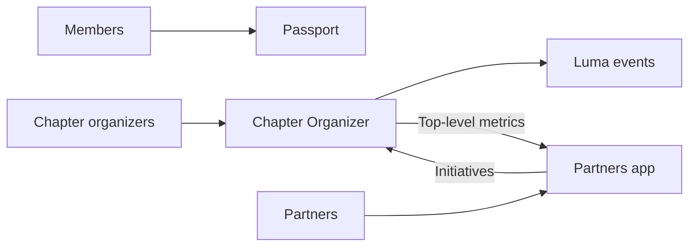

# The AI Collective · Apps

Open-source applications for connecting The AI Collective's members, chapter organizers, and partners. This repository brings their development together in a Turborepo workspace.

## The vision



### Roadmap

The applications are **boilerplate**, not completed products. The following capabilities describe the intended direction:

- **Passport:** an app for The AI Collective's members.
- **Chapter Organizer:** an event-organizing layer on top of Luma, with chapter member filters, imports and exports. The invitation flow starts with SMS or email invitations to request attendance, followed by Luma invitations for direct RSVP, using schedulers to pool limited Luma invites. Organizers can shortlist attendees from the waitlist. Chapter-level read and write roles are planned at `organize.aicollective.com/<chapter-id>`.
- **Partners:** a management platform for rolling out initiatives to chapters and viewing top-level metrics. Partner-level read and write roles are planned at `partner.aicollective.com/<partner-slug>`.

The diagram illustrates this roadmap; integrations, roles, and workflows have not yet been implemented.

## Workspace

| App | Location | Local URL |
| --- | --- | --- |
| Passport | `apps/passport` | http://localhost:3000 |
| Chapter Organizer | `apps/chapter` | http://localhost:3001 |
| Partners | `apps/partners` | http://localhost:3002 |

Each app uses Next.js, TypeScript, and Effect. Its `/api/health` route demonstrates running an Effect and returns the app name and status.

## Getting started

Use Node.js 20.9 or later and npm 10:

```sh
npm ci
npm run dev
```

This starts all three apps on their respective ports. To work on one app:

```sh
npm run dev -- --filter=@collective/chapter
```

Replace `chapter` with `passport` or `partners` as needed. Other workspace commands:

```sh
npm run typecheck
npm run build
```

## License

See [LICENSE](LICENSE).
